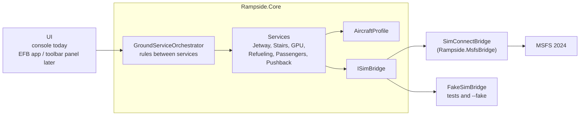

# Rampside architecture

## Goals

1. **Free and open.** No paid parts, no closed parts; anyone can add aircraft and airports.
2. **Works with every aircraft out of the box** using default sim variables, with profiles for better results.
3. **Simulator-independent core.** All rules and timing live in plain C# that runs and is tested without MSFS.
4. **Small steps.** Use the simulator's built-in ground equipment first; custom vehicles and animations come later.

## Overview



### Rampside.Core

- **`ISimBridge`** is the only contact point with the simulator: read `AircraftState`, write fuel and payload,
  send key events, drive ground motion. Everything uses SI units (kg, m/s, rad/s); bridges convert.
- **Services** (`GroundService` subclasses) share one lifecycle:
  `Idle → Starting → Active → Finishing → Completed` (or `Aborted`).
  `Detail` carries the human-readable sub-state, `Progress` the 0..1 progress.
  Services are ticked at a fixed rate (the app uses 20 Hz) and never block.
- **`GroundServiceOrchestrator`** owns the services of one aircraft and is the API for every UI.
  Each command returns a `CommandResult` (accepted or rejected with a reason). Rules include:
  - the aircraft must be stationary on the ground for any service
  - boarding needs a connected jetway or stairs; the last access cannot be removed during boarding
  - no refueling with engines running (unless the profile allows it)
  - pushback needs jetway, stairs and GPU disconnected and boarding and refueling finished
- **`FakeSimBridge`** simulates an aircraft (fuel tanks, parking brake, position integration) for tests and
  for working on Rampside without the sim.

### Aircraft adapters and procedures

Services never write fuel, payload or doors or call ground equipment directly; they go through an
`IAircraftAdapter`. Aircraft differ job by job (a PMDG 737 brings its own stairs through the CDU, an Asobo
aircraft uses the sim's ground services), so the adapter is put together from **one procedure per job**
(`ComposedAircraftAdapter`, `Aircraft/Procedures/`). The profile's `adapter` field names the aircraft
**family**, which sets the usual procedure for every job; `procedures` in the profile changes single jobs.

| Job | Procedures | `default` family | `pmdg-737` family |
| --- | --- | --- | --- |
| `doors` | `none`, `pmdg-sdk` (door events, state from the door lights) | `none` | `pmdg-sdk` |
| `jetway` | `none`, `sim` (`TOGGLE_JETWAY`) | `sim` | `sim` |
| `stairs` | `none`, `sim` (`TOGGLE_RAMPTRUCK`), `pmdg-cdu` (PMDG stairs via the CDU) | `sim` | `pmdg-cdu` |
| `groundPower` | `none`, `sim` (`REQUEST_POWER_SUPPLY`), `pmdg-cdu` (PMDG GPU via the CDU) | `sim` | `pmdg-cdu` |
| `chocks` | `none`, `pmdg-cdu` (WHEEL CHOCKS on the CDU) | `none` | `pmdg-cdu` |
| `fuel` | `none` (aircraft's own menus), `sim` (fuel tank variables) | `sim` | `none` |
| `payload` | `none`, `sim` (`PAYLOAD STATION WEIGHT:n`) | `sim` | `none` |

Rules: an unknown name falls back to `none` and is logged; `none` refuses the job with "use the aircraft's own
menu" instead of sending an event that does nothing. A family can be marked SDK-only (PMDG: its EULA forbids
writing sim variables), then `sim` fuel and payload are refused. Procedures that see the equipment (`pmdg-cdu`)
report its real state; `sim` stairs and GPU are not visible yet and follow the profile's timing. Procedures share
helpers through `ProcedureContext` (e.g. one PMDG CDU driver, so key presses never mix).

Adding an aircraft: write only the procedures that differ (e.g. `asobo-efb` stairs), add them to
`AircraftProcedureCatalog.Names` and the factory switch, and either add a family or override jobs in the profile.

The orchestrator automates doors when the adapter controls them: jetway or stairs connected → their doors
open; before they are removed → doors close (unless the other equipment still uses them); boarding →
cargo doors open, closed when done. Pushback is refused while any door is open.

### PMDG 737

Rampside uses only the PMDG SDK, as the PMDG EULA requires. Nothing from PMDG is in this repository:

- `PmdgSdkLocator` finds `PMDG_NG3_SDK.h` in the user's MSFS package folders (Store and Steam, including a
  custom `InstalledPackagesPath`). Override with the `RAMPSIDE_PMDG737_HEADER` environment variable.
- `PmdgSdkHeader` parses it at runtime: `#define` values (event ids, client data names) and the struct layouts
  with MSVC x64 alignment. Checked against clang for every field of the 737 header (916-byte data area).
  When PMDG changes the layout in an update, Rampside follows automatically.
- `PmdgSimConnectLink` subscribes to the data and CDU client data areas. The managed SimConnect wrapper needs a
  fixed-size struct, so the area is read as 16 chunks of 256 bytes (the last ones shifted back to stay inside
  the area) and put back together (`ClientDataChunks`).
- Events are sent by number (`#83637` for `EVT_DOOR_FWD_L`).

The aircraft only sends data with these lines in `737_Options.ini`
(`%LOCALAPPDATA%\Packages\Microsoft.Limitless_8wekyb3d8bbwe\LocalState\WASM\MSFS2024\pmdg-aircraft-738\work\`
for the Store edition):

```ini
[SDK]
EnableDataBroadcast=1
EnableCDUBroadcast.0=1
EnableCDUBroadcast.1=1
```

`EnableCDUBroadcast.1` (right CDU) is needed for stairs and ground power, see below. The PMDG only reads these
lines when the aircraft is loaded; until then the right CDU's data area exists but stays empty.

Verified in the sim (PMDG 737-800, MSFS 2024, 30 Oct 2026): data and CDU broadcast arrive and decode correctly
(PMDG fuel matches the sim's fuel), door events with parameter 1 open and close the doors, and the door lights
follow within a few seconds. Door lights work on battery power alone.

Door mapping (profile field `doorMap`, verified with the aircraft powered): each door has a toggle event and a
door light that is on while the door is not closed. Lights come on within 0.5 s of the open event; closing takes
about 10 s (L1), 5 s (R1, L2, R2) and 3 s (cargo doors). The PMDG **ignores a door event while that door is still
moving**, so the adapter keeps the wanted state per door, sends at most one event per door every 12 s and repeats
it (up to three times) if the door has not reached that state. Without DC power the door lights are dark, the state
is unknown and door requests are dropped instead of being carried out later.

Stairs and ground power (verified 30 Oct 2026): the PMDG brings its own vehicles (SimObjects such as
`PMDG_Stairs_1L`) and ignores the sim's `TOGGLE_RAMPTRUCK` / `REQUEST_POWER_SUPPLY`. They are requested on the CDU:
MENU → FS ACTIONS (R5) → GROUND SERVICES (R1); page 1/4 has GROUND POWER `<REQUEST` at L2, page 3/4 has
STAIRS 1L and STAIRS 2L at L1/L2 (`<REQUEST` / `<RELEASE`). `PmdgCduDriver` presses the keys on the **right
(first officer's) CDU only**, deciding every key from the broadcast screen, so the pilot can keep working on the
left CDU. CDU keys take parameter `0x20000000` (left click). Detection: the GPU counts as connected while
`ELEC_annunGRD_POWER_AVAILABLE` is lit; the stairs while a `PMDG_Stairs_*` object stands still within 40 m of the
aircraft (`NearbyObjectScanner` lists SimObjects within 80 m every 2 s). While a request is under way (up to
3 minutes) the equipment is reported as moving.

Wheel chocks: WHEEL CHOCKS at R6 on every GROUND SERVICES page; the key toggles, and the selected option
(SET or REMOVED) is in the large green font, the other in the small font (read from the cell flags of the CDU
broadcast). Nothing else shows the chocks (no SDK field, no SimObject), so their state is only known after the
right CDU showed that page: while unknown and readable, Rampside opens GROUND SERVICES there once in a while
without pressing anything. On a dark CDU with unknown state a chocks request is refused rather than toggled blind.
Pushback is refused while the chocks are set. Equipment whose procedure is `none` (chocks on most aircraft) is
left out of the UI.

Cold and dark (only DC HOT BATT powered): both CDUs show MENU, but the broadcast reports them off with an empty
screen, so they cannot be read. The keys still work, and the GRD POWER AVAILABLE light is still reported. In that
case (and before the aircraft was reloaded with `EnableCDUBroadcast.1=1`) the driver presses the fixed sequence
MENU, R5, R1, NEXT_PAGE…, item key blind on the right CDU. Because the item keys toggle, a blind press only
happens when the observed state (light, `PMDG_Stairs_1L`/`_2L` truck) differs from the wanted one. Verified on
30 Oct 2026: GPU released and requested again this way; the cart is the SimObject `PMDG_GPU`.

Not usable: the sim's `EXIT OPEN:n` variables do not follow the PMDG doors (exit 0 stayed at 100 % while L1 was
closed); the airstair event extended the stairs once without power but did not retract them with power; the
overwing exit events do nothing on the ground.

Still open: which DC buses exactly power the door lights (Rampside requires any of DC BATT, DC STBY, DC 1, DC 2)
and the CDU pages for fuel and payload.

PMDG EULA requirements before publishing the PMDG part: users must accept the PMDG SDK EULA on first use,
the PMDG integration is for private use only, and tools that change PMDG ini files must be offered to PMDG for
review. See [support.pmdg.com](http://support.pmdg.com).

### Stand and jetway detection

`StandMonitor` (an extension of the SimConnect bridge) fills `AircraftState.Stand` while the aircraft is parked:

1. nearest airport from the facility list (`RequestFacilitiesList`, within 8 km),
2. its parking spots from the facility data (`TAXI_PARKING`: name code, number, radius, offset from the airport
   reference point), cached per airport,
3. the spot whose circle (radius + 15 m) contains the aircraft,
4. once per second `RequestJetwayData` for the airport, matched to the stand by **parking index**
   (the position in the airport's parking list, e.g. index 156 = EDDM gate 121, not the stand number).

Jetway status codes observed in MSFS 2024: 0 at rest, 1 → 2 → 3 while attaching (about 33 s), 7 fully attached;
`AttachedObjectId` is the user aircraft's object id from the first second of movement. The orchestrator feeds this
into the jetway service, so a jetway moved by GSX, the sim or the user is shown correctly and blocks pushback;
stands without a jetway refuse the jetway command. The doors of the jetway open 8 s after it attached
(`doors.jetwayOpenDelaySeconds`), since the sim may open the door itself.

Not available from SimConnect so far: the state of the sim's stairs trucks and other service vehicles.

### Flight plans (SimBrief)

`ofp` fetches the user's latest SimBrief OFP (`xml.fetcher.php?userid=` or `?username=`, public, no login) on
request only (console `ofp`, desktop "Load from SimBrief" on the Boarding tab; a refused plan offers "Load anyway").
The user is set on the desktop **Settings** tab ("Test" fetches the latest plan without loading it) and stored in
`%APPDATA%\Rampside\settings.json` (`RampsideSettings`), shared with the console; `--simbrief <pilot id or username>`
and `RAMPSIDE_SIMBRIEF` override it in the console. XML is used instead of
JSON: it is documented, has numbers as numbers and times as Unix seconds. `SimBriefOfpParser` turns it into a
`FlightPlan` in kg:

| OFP field | Use |
| --- | --- |
| `params/units` | `kgs` or `lbs`, converts all weights |
| `params/request_id` | identifies the plan |
| `origin/icao_code`, `aircraft/icaocode` | checks against the sim |
| `weights/pax_count_actual`, `pax_weight` | passengers and mass per passenger (without bags) |
| `weights/cargo`, `freight_added` | everything in the holds (bags + freight), and its freight part |
| `fuel/plan_ramp` | block fuel, the default for `refuel` |
| `weights/oew`, `est_zfw` | compared with the sim's `EMPTY WEIGHT` |

Checked against a real OFP (30 Oct 2026): `payload = pax_count_actual × pax_weight + cargo` and
`est_zfw = oew + payload`. The `_actual` counts are the load sheet with SimBrief's random variation, and `cargo` is
not exactly `bag_count_actual × bag_weight`, so Rampside takes `cargo` as it is. The OFP has no gate or stand.

`FlightPlanCheck` compares the plan with the aircraft. A different **aircraft type** (profile `icaoTypes`, else the
sim's `ATC MODEL`) or **departure airport** (the stand's airport, else the nearest airport within 8 km) refuses the
plan; `ofp force` loads it anyway. What cannot be checked is listed but does not block. Warnings only: plan older than
24 h, more passengers than the profile seats, block fuel above tank capacity, empty weight more than 500 kg off.

With a plan loaded, `board` boards its passengers with its masses and loads its cargo in step with them (fewer
passengers: bags shrink, freight stays), so the sim's zero fuel weight matches the OFP when the empty weights agree.
`refuel` without an amount fills to block fuel. The plan cannot change while passengers board, or while passengers
of the current plan are on board (unless forced). Adapters that cannot set fuel or payload (PMDG 737 for now) only
show the numbers.

Not yet: scheduled times (`times/sched_out`) for a turnaround timeline, and keeping the plan when the orchestrator
is rebuilt (sim restart, aircraft change). Before publishing: ask Navigraph whether an open-source tool may use
`xml.fetcher.php` without a Navigraph client id, and keep their names out of the app name.

### Rampside.Hosting

`RampsideHost` runs Rampside for any front end: it connects the simulator, picks profile and adapter, ticks the
services at 20 Hz on its own loop and publishes an immutable `RampsideSnapshot` five times per second. Commands
go through `ExecuteAsync`/`InvokeAsync` and run on the loop, because the orchestrator is not thread-safe. The
console (`Rampside.App`) and the desktop window both use it.

### Rampside.MsfsBridge

`SimConnectBridge` uses the managed SimConnect wrapper from the MSFS SDK. The DLLs are not in the repo;
`Directory.Build.props` finds them through `MSFS2024_SDK`/`MSFS_SDK` or `-p:MsfsSdkRoot`. Without the SDK the
project builds empty and the app falls back to the fake sim, so contributors and CI do not need the SDK.

- Connection loop on its own thread, retrying every 5 s, reconnecting after the sim quits.
- Aircraft state is requested every 5 sim frames, including `ATC MODEL` (ICAO type) and `EMPTY WEIGHT` for the
  flight plan check. The exact `ATC MODEL` format in MSFS 2024 is still to be confirmed per aircraft.
- Fuel: `FUEL TANK LEFT MAIN/RIGHT MAIN/CENTER QUANTITY` in gallons, converted with `FUEL WEIGHT PER GALLON`.
- Payload: `PAYLOAD STATION WEIGHT:n` in pounds, defined on first use per station.
- Equipment: key events from the profile, defaults in `SimEvents` (`TOGGLE_JETWAY`, `TOGGLE_RAMPTRUCK`,
  `REQUEST_POWER_SUPPLY`).
- Pushback: writes `VELOCITY BODY Z` and `ROTATION VELOCITY BODY Y`. Rampside sends them every tick; the bridge
  repeats the latest values every sim frame (stopping when no new values come for 0.5 s), so nothing builds up
  between ticks. The tug is placed every frame too, also while the aircraft stands: left alone, the sim's vehicle rolls.
- Pushback tug: the sim's own ground vehicle (`tugTitle`, default `ASO_Pushback_White`), spawned with
  `AICreateSimulatedObject_EX1` 25 m ahead of the nose when the pushback is called. It drives up to the nose wheel
  (a `VehicleDrive`: path, time, sin² over the distance, so it starts and stops gently) and arrives 5 s before
  `connectSeconds` end. While connected it is attached to the aircraft: the bridge reads
  `PLANE LATITUDE/LONGITUDE/HEADING` every sim frame and writes the tug's `Initial Position` right away, so it moves
  with the aircraft without lagging (the main aircraft state only arrives every sixth frame, too coarse for this).
  After disconnecting (once the nose wheel is down) it drives 20 m ahead of the aircraft, cab first, then back to
  10 m ahead of where it connected at the stand, where the bridge removes it. Aborted before connecting, it is
  removed at once.

### Pushback model

Pushback uses a bicycle model: `yawRate = speed / wheelbase × tan(steeringAngle)`. Speed and steering angle
ramp towards their targets (`accelerationMps2`, `steeringRateDegPerSecond`), so the movement starts and
stops smoothly. Steering is given the way a ground crew says it: *tail left* / *tail right*.

Sequence: tug connects → waits for parking brake release → pushes → on `stop` slows to zero and holds the
aircraft → waits for parking brake → tug disconnects. Setting the parking brake while moving stops at once.

The default tug is towbarless: the nose wheel sits in its cradle. Its reference point is `tugDistanceMeters`
ahead of the nose gear, and it faces the aircraft. It turns with the nose wheel, so it swings out to the side
the nose wheel is steered to. `noseGearForwardMeters` is the nose wheel contact point from the aircraft's
`flight_model.cfg` (`point.0` x, in feet there); without it Rampside assumes 80 % of `wheelbaseMeters`.

Like a real towbarless tug (and GSX), the tug lifts the nose wheel off the ground once connected, so it does not
scrub while the pushback steers: the bridge writes `PLANE PITCH DEGREES` every sim frame, raising the nose by
`noseLiftDeg` over `noseLiftSeconds` along a sin² curve, holds it during the push and sets it down the same way
(lifting makes the aircraft creep forwards despite the parking brake, so while the nose is up or coming down and the
aircraft should stand, Rampside writes zero ground motion)
before the tug disconnects (also on abort), then hands the pitch back to the sim. The aircraft's own steering is not
used: the sim cannot be given a nose wheel angle (`GEAR STEER ANGLE` and `STEER INPUT CONTROL` are read-only,
`STEERING_SET` needs hydraulic pressure), and the PMDG's nose wheel animation follows that angle only.
Measured in MSFS 2024 with the PMDG 737: the nose wheel leaves the ground at about 1.7° nose up; GSX lifts about 2.4°.

### Planned pushback ("facing North-West")

Like GSX without a custom profile, but named by compass direction instead of "nose left / tail right":

1. `StandMonitor` loads the airport's taxiway graph with the parking spots (`TAXI_POINT`, `TAXI_PATH`,
   `TAXI_NAME` facility data) and hands it on in `StandInfo.Taxiways`. It is the scenery's own graph, so the
   push follows the lines the user sees.
2. `PushbackPlanner` follows the line behind the tail to the first taxi line it crosses (path types `TAXI` and
   `PATH`, 8–200 m behind). Each direction along that line is one option, named after the nearest of eight
   compass points of the final nose heading (true north): e.g. "facing North on N".
3. The path is straight back, an arc onto the line (`turnRadiusMeters`, smaller if the line is close, never
   tighter than the nose wheel allows) and `straightAfterTurnMeters` along the line.
4. `PushbackService` follows it with pure pursuit in reverse, slows down towards the end and stops by itself.
   Any steering command (`left`/`right`/`straight`) switches to manual.

### Pushback targets from GSX profiles

Where the user has GSX Pro airport profiles installed (`%APPDATA%\Virtuali\GSX\MSFS\<icao>-<name>.ini`),
their hand-made pushback targets ("Facing South - E1 Orange", "Area 3 - N5 (>South)") replace the planned options.
The profiles belong to their authors: Rampside reads them from the user's GSX folder at run time and never ships them.

1. `GsxProfileLibrary` lists the airport's `.ini` files and parses them (`GsxProfile`, cached until the file changes).
   The `pushbackaddpos` value is a Python literal, read by the small `PythonLiteral` reader; nothing is executed.
   The profile's `.py` script is read for the stop positions (see below); `*_handler.py` scripts are not.
2. The stand is matched by position: the GSX section whose `this_parking_pos` lies within 5 m of the MSFS parking
   spot. Section names alone are ambiguous ("gate a 317" can be A317 or 317A). Older sections without
   `this_parking_pos` fall back to the name, but only if their stop position lies on the spot.
3. Targets per stand: `pushbackleftpos`/`pushbackrightpos` with their `…approachpos`, `…approachpos2`, …
   (bit mask `pushback`: 1 = left, 2 = right, labels from `pushbacklabels`) plus every entry of `pushbackaddpos`.
   Each point carries the aircraft heading there.
4. `GsxPushbackBuilder` starts the path at the aircraft and joins the points with Bézier curves tangent to the
   given headings (handle length of a circular arc). A missing heading is taken from the next point.
   Targets that do not start behind the aircraft, or whose first heading is more than 135° off (the aircraft
   faces the other way), are left out. A GSX target can end with the tug towing the aircraft forwards
   (the Aerosoft EDDF profile does this in about a third of its targets); Rampside's tug only pushes, so the pushback ends where
   the forward part starts and the pilot taxis on from there.
5. Without a GSX stand, or when none of its targets fits, `PushbackPlanner` plans as above.

The orchestrator logs the match once per stand, e.g.
`GSX profile eddm-simwings: Gate 121 is [gate 121] (0.3 m from the MSFS spot), 4 of 4 pushback targets usable`.
In the console `push` lists the options numbered (`push 2` picks one), `taxi` shows the GSX stand.

### Stop positions per aircraft from GSX scripts

Next to many profiles lies a script with the same name (`eddm-simwings.py`). Its `parkings` table names, per stand,
a function marked `@AlternativeStopPositions` that GSX calls with the aircraft and that returns a `Distance`,
mostly a lookup in tables of GSX aircraft ids (`737: {800: 0, 900: 2}`, `380: 16.2`):

```python
parkings = {
    GATE_A : {
        None : (Pier1Names, customOffset14),   # default for the other GATE_A stands
        113 : (Pier1Names, customOffset14b),   # [gate a 113] in the .ini
    },
}
```

1. `PyModule` runs the script with a small interpreter for the part of Python 2 the scripts use (functions,
   decorators, if/elif/else, try/except, dicts and tuples, `%` formatting, `44L`). There are no imports, loops,
   classes or file access, and every run has a step budget and a call depth limit, so a script cannot reach the system
   or hang Rampside. A statement it cannot parse or run is skipped and logged; the rest still loads.
   Over the 27 scripts installed here (up to 5800 lines) it loads each in under 100 ms without problems.
2. `GsxStopOffsets` maps the table to the `.ini` section names (`GATE_A`, 113 → `gate a 113`; `N_PARKING` → `n parking`)
   and calls the function with `aircraftData` (`idMajor`, `idMinor`, `icaoTypeDesignator`, `aircraftGroup` = "ARC-C").
   A function that fails (e.g. `Distance.fromMeters(None)` when its table has no entry for the aircraft) gives no offset,
   as in GSX.
3. `GsxAircraft` gets GSX's id from the ICAO type (B738 → 737/800, B789 → 787/9, A388 → 380), read off the scripts' tables.
   A profile can set it with `"gsx": { "idMajor": 737, "idMinor": 800 }` where the type is not in the table.
4. `GsxStandMatch.StopPosition` is the profile's stop position moved back along the stand heading by the offset;
   the pushback distance check and the console's `taxi` report use it, and the orchestrator logs it
   (`stop position 16.2 m short for A388 (GSX 380/0) (customOffset14)`).

**Not checked in the sim yet:** that a positive offset means "stop short". It is read off the data: the bigger the
aircraft, the bigger the value (A320 and 737-800 around 0, widebodies 8–14 m, A380 about 16 m), roughly its extra
length from the nose to the reference point. Also unverified: GSX's ids for the 747-8 (8 or 800 appear in scripts),
the A320neo family (taken as the ceo ids) and the 737 MAX (taken as 737/700–900).

Not yet: GSX's start-engines and wingwalker hints.

## Aircraft profiles

JSON files in `profiles/`. Comments and trailing commas are allowed, every field is optional and falls back
to a default (see `AircraftProfile.cs`). The first profile whose `match` text is found in the aircraft
title wins (case-insensitive); otherwise `generic` is used.

| Section | Fields |
| --- | --- |
| (top level) | `id`, `name`, `match[]`, `icaoTypes[]` (e.g. `B738`; flight plans for other types are refused), `adapter` (family: `default` / `pmdg-737`), `procedures` (per job, see above: `doors`, `jetway`, `stairs`, `groundPower`, `chocks`, `fuel`, `payload`) |
| `doors` | `automatic`, `jetway[]`, `stairs[]`, `cargo[]` (door ids: `forwardLeft`, `forwardRight`, `aftLeft`, `aftRight`, `cargoForward`, `cargoAft`, `airstair`) |
| `passengers` | `capacity`, `weightKg`, `bagWeightKg`, `boardingPerMinute`, `deboardingPerMinute`, `preparationSeconds` |
| `payloadStations[]` | `index` (SimConnect, 1-based), `name`, `kind` (`passengers`/`cargo`), `share` |
| `fuel` | `rateKgPerMinute`, `truckArrivalSeconds`, `allowWithEnginesRunning` |
| `pushback` | `wheelbaseMeters`, `speedMps`, `accelerationMps2`, `maxSteeringDeg`, `steeringRateDegPerSecond`, `turnRadiusMeters`, `straightAfterTurnMeters`, `connectSeconds`, `disconnectSeconds`, `brakeReactionSeconds`, `tugTitle`, `noseGearForwardMeters`, `tugDistanceMeters`, `noseLiftDeg`, `noseLiftSeconds` |
| `jetway`, `stairs`, `gpu`, `chocks` | `event` (null = default, `""` = none), `connectSeconds`, `disconnectSeconds` |

Passenger mass goes to the `passengers` stations and bag mass to the `cargo` stations, each split by `share`.
Without a flight plan the masses come from `passengers.weightKg` and `bagWeightKg`; with one, from the plan.

## Roadmap

| Phase | Content |
| --- | --- |
| **0: foundation** (done) | Core services and rules, profiles, fake sim, SimConnect bridge, console host, tests |
| **1: in the sim** | Test the bridge in MSFS 2024; confirm event names, yaw sign and payload indexes; profiles for default airliners; config file for the app |
| **2: in-sim UI** | MSFS 2024 EFB app or toolbar panel; local API (WebSocket) between UI and the Rampside service; tray app instead of console |
| **3: the ramp** | Airport data from SimConnect facilities (parking spots, jetways); own vehicles and crew as SimObjects placed at the right door positions; pushback with a planned path |
| **4: depth** | Study-level aircraft (L-vars, input events, possibly a small WASM helper); turnaround timeline (GSX-style full flow); sounds; remember load sheet across sessions |

## Open questions and risks

- **Managed SimConnect wrapper on .NET 10.** Community tools use the SDK's managed DLL with modern .NET
  on x64. If it causes trouble, the fallback is a small P/Invoke layer over the native `SimConnect.dll`.
- **Ground motion through body velocities** can fight the sim's own physics. Better Pushback-style tools show it
  works; tuning (and maybe also writing position) will be needed.
- **Study-level aircraft** often ignore default fuel and payload variables and manage their own. They need
  profile extensions that write the aircraft's own variables.
- **UI channel.** In-sim panels and an external app need a link: a local WebSocket is the simplest; the
  MSFS CommBus via a WASM module is the alternative if WebSocket is not reliable.
- **Assets.** Own vehicles need 3D models under an open license; until then Rampside uses the sim's built-in
  ground equipment.
