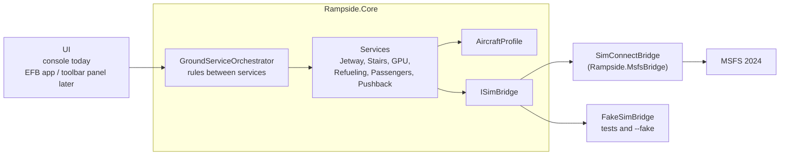

# Rampside architecture

## Goals

1. **Free and open.** No paid parts, no closed parts; anyone can add aircraft and airports.
2. **Works with every aircraft out of the box** using default sim variables, with profiles for better results.
3. **Simulator-independent core.** All rules and timing live in plain C# that runs and is tested without MSFS.
4. **Small steps.** Use the simulator's built-in ground equipment first; custom vehicles and animations come later.

## Overview

### Rampside.Core

- **`ISimBridge`** is the only contact point with the simulator: read `AircraftState`, write fuel and payload,
  send key events, drive ground motion. Everything uses SI units (kg, m/s, rad/s); bridges convert.
- **Services** (`GroundService` subclasses) share one lifecycle:
  `Idle → Starting → Active → Finishing → Completed` (or `Aborted`).
  `Detail` carries the human-readable sub-state, `Progress` the 0..1 progress.
  Services are ticked at a fixed rate (the app uses 20 Hz) and never block.
- **`GroundServiceOrchestrator`** owns the services of one aircraft and is the API for every UI.
  Each command returns a `CommandResult` (accepted or rejected with a reason). Rules include:
  - the aircraft must be stationary on the ground for any service
  - boarding needs a connected jetway or stairs; the last access cannot be removed during boarding
  - no refueling with engines running (unless the profile allows it)
  - pushback needs jetway, stairs and GPU disconnected and boarding and refueling finished
- **`FakeSimBridge`** simulates an aircraft (fuel tanks, parking brake, position integration) for tests and
  for working on Rampside without the sim.

### Rampside.MsfsBridge

`SimConnectBridge` uses the managed SimConnect wrapper from the MSFS SDK. The DLLs are not in the repo;
`Directory.Build.props` finds them through `MSFS2024_SDK`/`MSFS_SDK` or `-p:MsfsSdkRoot`. Without the SDK the
project builds empty and the app falls back to the fake sim, so contributors and CI do not need the SDK.

- Connection loop on its own thread, retrying every 5 s, reconnecting after the sim quits.
- Aircraft state is requested every 5 sim frames.
- Fuel: `FUEL TANK LEFT MAIN/RIGHT MAIN/CENTER QUANTITY` in gallons, converted with `FUEL WEIGHT PER GALLON`.
- Payload: `PAYLOAD STATION WEIGHT:n` in pounds, defined on first use per station.
- Equipment: key events from the profile, defaults in `SimEvents` (`TOGGLE_JETWAY`, `TOGGLE_RAMPTRUCK`,
  `REQUEST_POWER_SUPPLY`).
- Pushback: writes `VELOCITY BODY Z` and `ROTATION VELOCITY BODY Y` every tick while the tug moves the aircraft.

### Pushback model

Pushback uses a bicycle model: `yawRate = speed / wheelbase × tan(steeringAngle)`. Speed and steering angle
ramp towards their targets (`accelerationMps2`, `steeringRateDegPerSecond`), so the movement starts and
stops smoothly. Steering is given the way a ground crew says it: *tail left* / *tail right*.

Sequence: tug connects → waits for parking brake release → pushes → on `stop` slows to zero and holds the
aircraft → waits for parking brake → tug disconnects. Setting the parking brake while moving stops at once.

## Aircraft profiles

JSON files in `profiles/`. Comments and trailing commas are allowed, every field is optional and falls back
to a default (see `AircraftProfile.cs`). The first profile whose `match` text is found in the aircraft
title wins (case-insensitive); otherwise `generic` is used.

| Section | Fields |
| --- | --- |
| `passengers` | `capacity`, `weightKg`, `bagWeightKg`, `boardingPerMinute`, `deboardingPerMinute`, `preparationSeconds` |
| `payloadStations[]` | `index` (SimConnect, 1-based), `name`, `kind` (`passengers`/`cargo`), `share` |
| `fuel` | `rateKgPerMinute`, `truckArrivalSeconds`, `allowWithEnginesRunning` |
| `pushback` | `wheelbaseMeters`, `speedMps`, `accelerationMps2`, `maxSteeringDeg`, `steeringRateDegPerSecond`, `connectSeconds`, `disconnectSeconds` |
| `jetway`, `stairs`, `gpu` | `event` (null = default, `""` = none), `connectSeconds`, `disconnectSeconds` |

Passenger mass goes to the `passengers` stations and bag mass to the `cargo` stations, each split by `share`.

## Roadmap

| Phase | Content |
| --- | --- |
| **0: foundation** (done) | Core services and rules, profiles, fake sim, SimConnect bridge, console host, tests |
| **1: in the sim** | Test the bridge in MSFS 2024; confirm event names, yaw sign and payload indexes; profiles for default airliners; config file for the app |
| **2: in-sim UI** | MSFS 2024 EFB app or toolbar panel; local API (WebSocket) between UI and the Rampside service; tray app instead of console |
| **3: the ramp** | Airport data from SimConnect facilities (parking spots, jetways); own vehicles and crew as SimObjects placed at the right door positions; pushback with a planned path |
| **4: depth** | Study-level aircraft (L-vars, input events, possibly a small WASM helper); turnaround timeline (GSX-style full flow); sounds; remember load sheet across sessions |

## Open questions and risks

- **Managed SimConnect wrapper on .NET 10.** Community tools use the SDK's managed DLL with modern .NET
  on x64. If it causes trouble, the fallback is a small P/Invoke layer over the native `SimConnect.dll`.
- **Ground motion through body velocities** can fight the sim's own physics. Better Pushback-style tools show it
  works; tuning (and maybe also writing position) will be needed.
- **Study-level aircraft** often ignore default fuel and payload variables and manage their own. They need
  profile extensions that write the aircraft's own variables.
- **UI channel.** In-sim panels and an external app need a link: a local WebSocket is the simplest; the
  MSFS CommBus via a WASM module is the alternative if WebSocket is not reliable.
- **Assets.** Own vehicles need 3D models under an open license; until then Rampside uses the sim's built-in
  ground equipment.
